# Value at Risk

[](https://github.com/Dhirajdas18/value-at-risk/actions/workflows/ci.yml)
[](https://dhirajdas18.github.io/value-at-risk/)

How much a portfolio can lose on a bad day, measured the ways risk desks do and tested on NSE data since
2009: historical, parametric and Monte Carlo VaR, expected shortfall, formal backtests, filtered historical
simulation, extreme value theory, risk decomposition, stress tests and option positions.

**Live calculator: [dhirajdas18.github.io/value-at-risk](https://dhirajdas18.github.io/value-at-risk/)**.
Enter rupee holdings in any of today's NIFTY 50 stocks or the NIFTY and gold ETFs and get 1-day VaR and expected
shortfall by four methods, 10-day historical VaR, each holding's share of the risk and four replayed crashes. It runs in your browser on five years of daily returns, rebuilt weekly; nothing
you enter leaves the page.

## Features

- [x] Historical, normal, Cornish-Fisher and Monte Carlo (normal, Student-t) VaR and expected shortfall; 10-day horizons
- [x] In-browser calculator, tested against the Python implementation through Node
- [x] Backtesting: Kupiec, Christoffersen, Basel traffic light
- [x] Filtered historical simulation (EWMA / GARCH), also in the calculator
- [x] Expected shortfall at 97.5% and its backtest (Acerbi-Székely)
- [x] Extreme value theory (peaks over threshold) for 99.9%
- [x] Risk by holding (component and marginal expected shortfall); historical stress scenarios, also in the calculator
- [x] Options books: delta, delta-gamma and delta-gamma-vega VaR against full repricing

## Findings

### 1. A normal curve put NIFTY's 99% one-day loss 16% too low and its expected shortfall 31% too low

<a href="docs/img/methods_distribution.png"><picture><source media="(prefers-reduced-motion: reduce)" srcset="docs/img/methods_distribution.png"></picture></a>

₹10 lakh in three portfolios, daily returns from January 2009 to November 2026 (4,413 days): the NIFTY 50
ETF (NIFTYBEES), five large stocks in equal amounts (Reliance, HDFC Bank, Infosys, TCS, ITC), and 70% NIFTY
ETF / 30% gold ETF (GOLDBEES). VaR at 99% is the one-day loss exceeded on only 1% of days; expected
shortfall (ES) is the average loss on those days.

| ₹10 lakh, 99%, one day | Historical | Normal | Monte Carlo, normal | Monte Carlo, Student-t |
|---|---|---|---|---|
| NIFTY ETF: VaR / ES | ₹28,415 / ₹39,485 | ₹23,830 / ₹27,383 | ₹23,946 / ₹27,551 | ₹27,134 / ₹36,779 |
| 5 large stocks | ₹28,362 / ₹40,288 | ₹25,385 / ₹29,192 | ₹25,635 / ₹29,362 | ₹29,127 / ₹39,897 |
| 70% NIFTY / 30% gold | ₹19,542 / ₹30,027 | ₹17,788 / ₹20,459 | ₹17,877 / ₹20,548 | ₹20,239 / ₹27,977 |

- **The bell curve is too thin in the tail:** for the NIFTY ETF, normal VaR was 16% below historical and
  normal ES 31% below. The normal 99% VaR was breached on 1.50% of days instead of 1%.
- **Monte Carlo is only as good as its assumption:** with normal draws it reproduced the normal formula;
  with Student-t draws matched to the data's fat tails (4.4 degrees of freedom) it came within 5% of
  historical VaR and 7% of historical ES.
- **Cornish-Fisher broke:** its correction for skew and fat tails is only valid while the corrected curve
  keeps rising, which fails above an excess kurtosis of 8 when there is no skew (its slope at the centre is
  1 − 3K/24); NIFTY's daily returns had 14.0, and it returned an absurd ₹56,438. The calculator checks this and says so.
- **Gold cut the risk:** moving 30% into gold lowered historical VaR from ₹28,415 to ₹19,542.

<table><tr>
<td><a href="docs/img/methods_compare.png"><picture><source media="(prefers-reduced-motion: reduce)" srcset="docs/img/methods_compare.png"></picture></a></td>
<td><a href="docs/img/methods_horizon.png"><picture><source media="(prefers-reduced-motion: reduce)" srcset="docs/img/methods_horizon.png"></picture></a></td>
</tr></table>

- **The √10 shortcut (right):** regulators scale one-day VaR to ten days by √10. On the NIFTY ETF that
  matched actual ten-day VaR (from overlapping ten-day windows) at 95% (4.8% vs 4.8%) but overstated it at
  99% (9.0% vs 7.7%) and 99.5% (11.1% vs 9.0%). Ten-day returns have thinner tails than daily ones: excess
  kurtosis 14.0 for daily returns against 8.4 for non-overlapping ten-day returns.

### 2. Only a slow VaR breached as often as promised, and its breaches came in bunches

<a href="docs/img/backtest_breaches.png"><picture><source media="(prefers-reduced-motion: reduce)" srcset="docs/img/backtest_breaches.png"></picture></a>

Each day from January 2013 to November 2026 (3,413 days), a 99% VaR forecast from past data only, compared
with that day's return. A good VaR is breached on about 1% of days (Kupiec's test) and its breaches arrive at
random, not in clusters (Christoffersen's test: is a breach more likely the day after a breach?).

| NIFTY ETF, 99% | Breaches | Right count? (Kupiec p) | Breach the day after a breach | Days in Basel red |
|---|---|---|---|---|
| Historical, 250 days | 1.70% | no (p < 0.01) | 5.2% | 6% |
| Historical, 1000 days | **1.08%** | **yes (p = 0.63)** | **18.9%** (p < 0.01) | 8% |
| Normal, 250 days | 2.08% | no (p < 0.01) | 9.9% | 12% |
| Student-t, 250 days | 1.67% | no (p < 0.01) | 8.8% | 7% |

- **Every one-year method breached too often:** 1.67% to 2.08% of days against the promised 1%, the normal
  curve worst of all.
- **The 1000-day VaR got the count right but not the timing:** after a breach, another followed the next day
  18.9% of the time instead of 1%. As the chart above shows, its VaR barely moved through March 2020 while
  the 250-day VaR rose to 6%, and it was breached again and again.

<table><tr>
<td><a href="docs/img/backtest_rates.png"><picture><source media="(prefers-reduced-motion: reduce)" srcset="docs/img/backtest_rates.png"></picture></a></td>
<td><a href="docs/img/backtest_traffic.png"><picture><source media="(prefers-reduced-motion: reduce)" srcset="docs/img/backtest_traffic.png"></picture></a></td>
</tr></table>

- **Five stocks behaved better (left):** the same methods on the five-stock portfolio breached less often
  (1.03% to 1.85%) and no method's breaches clustered significantly.
- **The Basel traffic light (right):** both historical VaRs reached the red zone (10 or more breaches in 250
  days) in 2020; the 1000-day VaR went deeper, to 16 breaches against 11, and stayed red from March 2020 to
  March 2021.

### 3. Rescaling history to today's volatility passed both backtests and never reached Basel's red zone

<a href="docs/img/fhs_scorecard.png"><picture><source media="(prefers-reduced-motion: reduce)" srcset="docs/img/fhs_scorecard.png">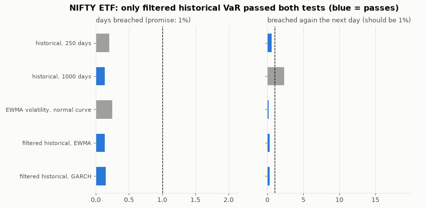</picture></a>

Filtered historical simulation divides each past day's return by that day's volatility forecast, keeps the
resulting shocks, and scales their historical quantile by tomorrow's volatility forecast: the tail's shape
comes from history and its size from today. Volatility is EWMA (RiskMetrics, λ 0.94) or GARCH(1,1)
refitted monthly on the previous 500 days; shocks from the previous 500 days. Same days as section 2.

| NIFTY ETF, 99%, 2013–2026 | Breaches | Right count? (Kupiec p) | Breach the day after a breach | Most breaches in 250 days |
|---|---|---|---|---|
| Historical, 1000 days | 1.08% | yes (0.63) | 18.9% (p < 0.01) | 16 (red) |
| EWMA volatility, normal curve | 2.05% | no (p < 0.01) | 1.4% | 12 (red) |
| **Filtered historical, EWMA** | **1.08%** | **yes (0.63)** | **2.7% (p = 0.42)** | **8** |
| Filtered historical, GARCH | 1.23% | yes (0.19) | 2.4% (p = 0.55) | 8 |

- **Two ingredients, two fixes:** scaling by current volatility fixed the timing (EWMA with a normal curve
  stopped clustering, 1.4% repeat breaches) but not the count (2.05%); keeping history's fat-tailed shocks
  fixed the count. Filtered historical simulation has both.
- **Cheaper on average:** its average VaR was 2.34% of the portfolio against 2.50% for the 1000-day method,
  with the same breach count.
- **Five stocks agree:** filtered historical, EWMA breached 1.08% of days there too, with no clustering.

<table><tr>
<td><a href="docs/img/fhs_crash.png"><picture><source media="(prefers-reduced-motion: reduce)" srcset="docs/img/fhs_crash.png">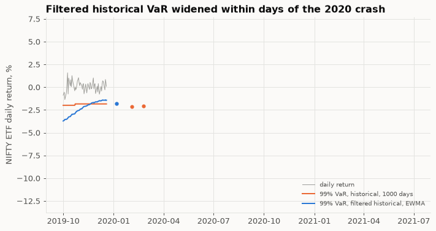</picture></a></td>
<td><a href="docs/img/fhs_traffic.png"><picture><source media="(prefers-reduced-motion: reduce)" srcset="docs/img/fhs_traffic.png"></picture></a></td>
</tr></table>

- **March 2020 (left):** on 23 March 2020 the filtered historical VaR stood at 10.0% of the portfolio,
  against 2.3% for the 1000-day historical VaR; the filtered one was breached early in the fall and then
  kept pace, the 1000-day one again and again.
- **Basel (right):** filtered historical VaR peaked at 8 breaches in 250 days (yellow) and never went red.

### 4. Basel's 97.5% expected shortfall asked for about the same capital as 99% VaR, and its backtest caught the methods that understate tail losses

<a href="docs/img/es_backtest.png"><picture><source media="(prefers-reduced-motion: reduce)" srcset="docs/img/es_backtest.png">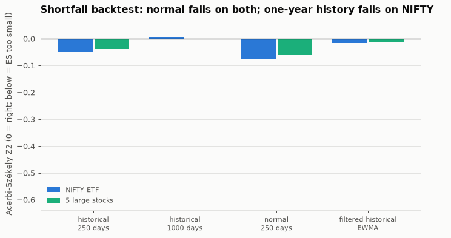</picture></a>

Basel's market-risk rules (FRTB) replaced 99% VaR with 97.5% expected shortfall: the average loss on the
worst 2.5% of days. For a bell curve the two are almost equal (2.338 against 2.326 standard deviations); ES
also responds to how bad the tail is. Same days and methods as sections 2–3 (filtered historical with 500
days of shocks). The backtest is Acerbi and Székely's Z2: the average of each day's return on breach days
divided by its forecast ES, which is 0 for a correct ES and negative when ES is too small; its p-value comes
from 1,000 simulations drawn from each day's own forecast distribution.

| 97.5% ES, 2013–2026 | NIFTY ETF: ES vs 99% VaR | Z2 (p) | 5 large stocks: Z2 (p) |
|---|---|---|---|
| Historical, 250 days | 2.40% vs 2.35% | −0.42 (p < 0.01) | −0.32 (p = 0.06) |
| Historical, 1000 days | 2.74% vs 2.50% | +0.04 (p = 0.63) | +0.00 (p = 0.47) |
| Normal, 250 days | 2.03% vs 2.02% | −0.61 (p < 0.01) | −0.50 (p < 0.01) |
| Filtered historical, EWMA | 2.37% vs 2.34% | −0.13 (p = 0.21) | −0.10 (p = 0.30) |

- **Same capital, better question:** ES at 97.5% averaged within 3% of 99% VaR for every method except the
  1000-day window (10% higher).
- **The backtest rejected the bell curve on both portfolios** and one-year history on the NIFTY ETF;
  filtered historical and the 1000-day window passed.
- **Z2 doesn't test timing:** the 1000-day window passed here, although its breaches clustered in section 2.
  An ES backtest checks the size of tail losses, not whether they bunch.

<table><tr>
<td><a href="docs/img/es_capital.png"><picture><source media="(prefers-reduced-motion: reduce)" srcset="docs/img/es_capital.png"></picture></a></td>
<td><a href="docs/img/es_by_year.png"><picture><source media="(prefers-reduced-motion: reduce)" srcset="docs/img/es_by_year.png">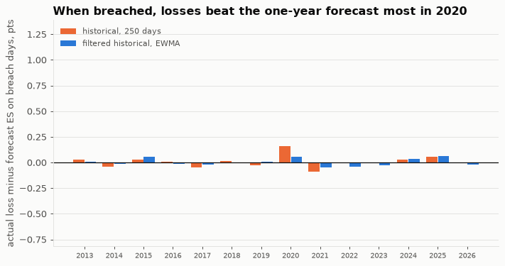</picture></a></td>
</tr></table>

- **Where the shortfall fell short (right):** on days the 97.5% VaR was breached, losses exceeded the
  one-year historical ES forecast by 1.3 points on average in 2020; filtered historical's gap that year was
  0.5 points.

### 5. A 10% one-day fall is a once-in-40-years event by extreme value theory and impossible by a normal curve; NIFTY had one in 18 years

<a href="docs/img/evt_tail.png"><picture><source media="(prefers-reduced-motion: reduce)" srcset="docs/img/evt_tail.png">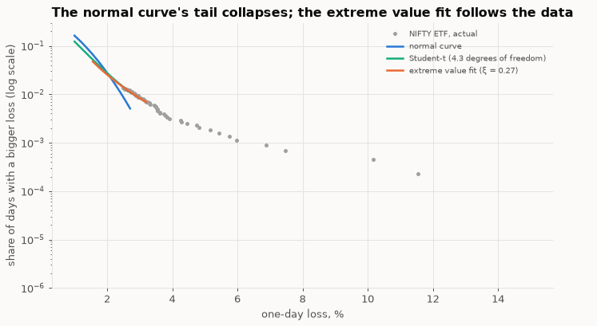</picture></a>

Extreme value theory fits only the tail: here the 221 days (5%) with the biggest losses on the NIFTY ETF,
January 2009 to November 2026, modelled with a generalised Pareto distribution (peaks over threshold). Its
shape ξ measures how fat the tail is: 0 is a thin, normal-like tail; above 0 the tail decays like a power.

- **NIFTY's tail is fat:** ξ = 0.21 (90% bootstrap range 0.08 to 0.31), and the lower end of the range stays
  above zero at every threshold tried from the 90th to the 97.5th percentile.

| One-day loss bigger than | Days it happened (17.9 years) | Extreme value: once every | Student-t | Normal curve |
|---|---|---|---|---|
| 5% | 7 | 2.8 years | 4.0 years | 5,700 years |
| 8% | 1 | 16.4 years | 28.5 years | 10¹¹ years |
| 10% | 1 | 40.0 years | 74.1 years | 10¹⁹ years |
| 13% | 0 | 118 years | 231 years | 10³² years |

- **One day can't settle the far tail:** the biggest loss, 10.2% on 23 March 2020, sits above the extreme
  value curve. With one such day in 17.9 years, the 90% Poisson range for its rate runs from once in 3.8 years to once in 349.

<table><tr>
<td><a href="docs/img/evt_levels.png"><picture><source media="(prefers-reduced-motion: reduce)" srcset="docs/img/evt_levels.png">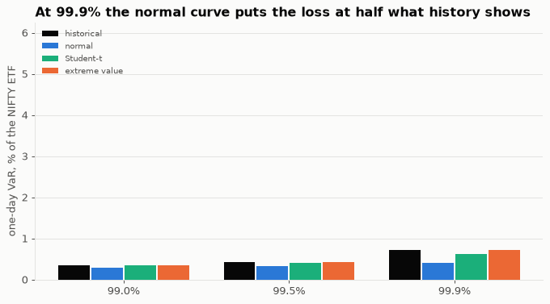</picture></a></td>
<td><a href="docs/img/evt_threshold.png"><picture><source media="(prefers-reduced-motion: reduce)" srcset="docs/img/evt_threshold.png">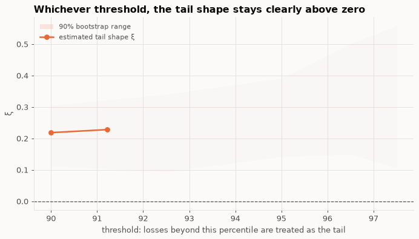</picture></a></td>
</tr></table>

- **At 99.9% (left):** VaR was 5.62% by history (resting on 5 days), 5.54% by extreme value theory (resting
  on 221), 5.00% by Student-t and 3.18% by a normal curve. ES at 99.9%: 7.25% historical, 7.46% extreme value.
- **Split test:** fitted on 2009–2019 and tested on 2020–2026 (1.7 breaches of a 99.9% VaR expected),
  historical, Student-t and extreme value VaR were each breached 4 times (Poisson p = 0.09); the normal curve
  9 times (p < 0.01). Extreme value theory didn't beat plain history at 99.9%; its value is a smooth tail that
  rests on many days and extends beyond the worst day seen.

### 6. The COVID crash cost 12 times the NIFTY ETF's 99% one-day VaR in 21 trading days; gold carried 15% of a 70/30 portfolio's risk over 18 years and 68% in the last one

<a href="docs/img/stress_scenarios.png"><picture><source media="(prefers-reduced-motion: reduce)" srcset="docs/img/stress_scenarios.png">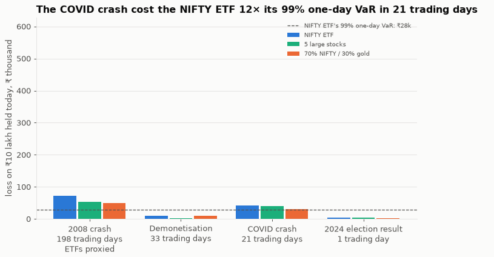</picture></a>

A stress test replays a dated episode on today's holdings: each holding's move between two closes, applied to
today's rupee amounts. VaR says how bad a normal bad day is; a stress test says what a named disaster would
cost. Losses on ₹10 lakh, and as a multiple of each portfolio's 99% one-day historical VaR (2009–2026):

| Episode (trading days) | NIFTY ETF | 5 large stocks | 70% NIFTY / 30% gold |
|---|---|---|---|
| 2008 crash, 8 Jan to 27 Oct (198) | ₹5,98,559 (21×)* | ₹4,32,022 (15×) | ₹4,11,998 (21×)* |
| Demonetisation, 8 Nov to 26 Dec 2016 (33) | ₹83,730 (2.9×) | ₹26,931 (0.9×) | ₹87,936 (4.5×) |
| COVID crash, 19 Feb to 23 Mar 2020 (21) | ₹3,50,494 (12×) | ₹3,22,692 (11×) | ₹2,59,157 (13×) |
| 2024 election result, 4 Jun (1) | ₹29,674 (1.0×) | ₹30,869 (1.1×) | ₹20,920 (1.1×) |

\* Neither ETF has prices on Yahoo before 2009. The NIFTY ETF is replaced by the NIFTY index it tracks
(−59.9%); gold is moved by its beta to NIFTY (−0.04), which puts it at +2.3%. That is a guess, not history.

- **Gold didn't cushion demonetisation:** the gold ETF fell 9.8% and the NIFTY ETF 8.4%, so the 70/30 mix
  lost more than NIFTY alone.
- **Election day, ETF against index:** on Yahoo's closing prices NIFTY fell 5.9% on 4 June 2024 and the ETF
  3.0%; the next day they rose 3.4% and 0.3%, so over the two days both fell 2.7%. Not checked against NSE's
  own closing prices; the one-day scenario uses Yahoo's close.

<table><tr>
<td><a href="docs/img/decomp_shares.png"><picture><source media="(prefers-reduced-motion: reduce)" srcset="docs/img/decomp_shares.png">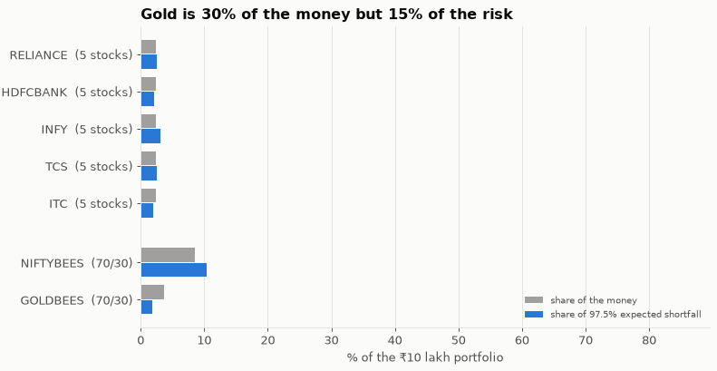</picture></a></td>
<td><a href="docs/img/decomp_incremental.png"><picture><source media="(prefers-reduced-motion: reduce)" srcset="docs/img/decomp_incremental.png">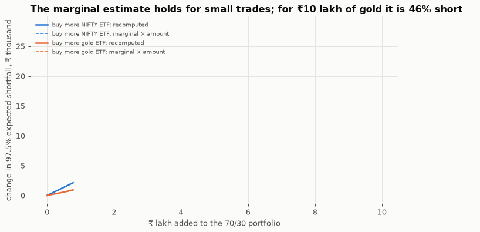</picture></a></td>
</tr></table>

- **Risk by holding (left):** each holding's component expected shortfall is its average loss on the
  portfolio's worst 2.5% of days; the components add up exactly to the portfolio's 97.5% ES. In the 5-stock
  portfolio, equal money gave INFY 25% of the risk and ITC 16%. In the 70/30 mix, gold was 30% of the money
  and 15% of the risk (the normal-curve VaR split says 14%).
- **The split depends on the window:** gold's share of the 70/30 risk was 15% over 2009–2026, 30% over the
  last 5 years, 48% over the last 3 and 68% over the last year. Over that year gold's daily volatility was
  2.0% against NIFTY's 0.86%, and it fell 10.5% on 30 January 2026 and 9.5% on 2 February.
- **Marginal against recomputed (right):** each extra rupee of NIFTY added 2.69 paise of ES and each rupee of
  gold 1.08 paise. That slope came within ₹1 of a full recomputation for ₹10,000 trades. For ₹1 lakh it was
  2% short for NIFTY and 12% short for gold; for ₹10 lakh, 6% and 46% short. The marginal is the slope at
  today's mix, and the recomputed curve for gold bends upward.

### 7. For option books, delta-gamma VaR erred both ways: 25% too low on a short put, 37% too high on a short straddle

<a href="docs/img/options_var.png"><picture><source media="(prefers-reduced-motion: reduce)" srcset="docs/img/options_var.png">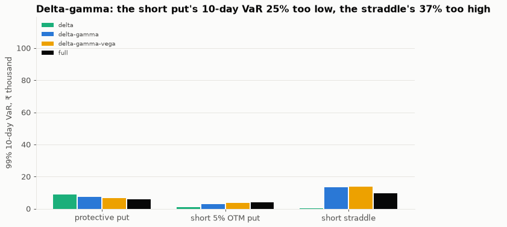</picture></a>

Three books of one-month NIFTY options, each on ₹10 lakh of notional, priced with Black-Scholes at the
close of 23 November 2026 (NIFTY 25,350, India VIX 17.7% as the volatility, 6.5% rate):
a **protective put** (the index plus a 5%-out-of-the-money put), a **short 5% OTM put**, and a **short
straddle** (sold call and put at the money). Each book is replayed through every NIFTY move since 2009, with
India VIX's move on the same days changing the volatility. The P&L comes four ways: delta (a straight line
in the move), delta-gamma (a parabola), delta-gamma plus vega, and full repricing of every option.

| 99% VaR, error against full repricing | Full repricing | Delta | Delta-gamma | Delta-gamma-vega |
|---|---|---|---|---|
| 1 day, protective put | ₹21,378 | +20% | +12% | +4% |
| 1 day, short 5% OTM put | ₹7,635 | −53% | −30% | −14% |
| 1 day, short straddle | ₹11,600 | −79% | −4% | +5% |
| 10 days, protective put | ₹48,903 | +48% | +21% | +14% |
| 10 days, short 5% OTM put | ₹33,330 | −76% | −25% | −14% |
| 10 days, short straddle | ₹80,615 | −98% | +37% | +41% |

<table><tr>
<td><a href="docs/img/options_payoff.png"><picture><source media="(prefers-reduced-motion: reduce)" srcset="docs/img/options_payoff.png">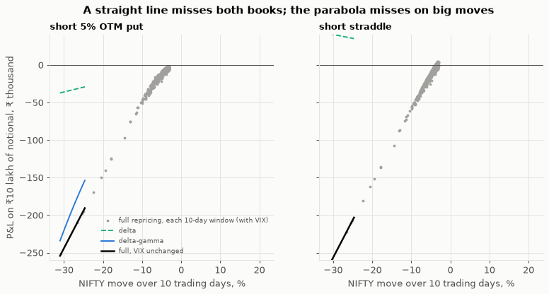</picture></a></td>
<td><a href="docs/img/options_error.png"><picture><source media="(prefers-reduced-motion: reduce)" srcset="docs/img/options_error.png">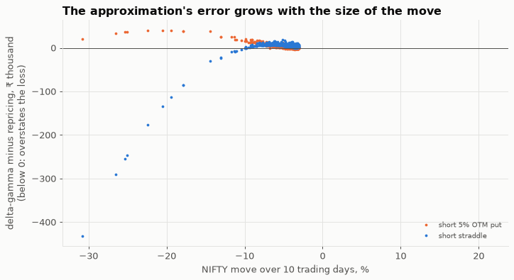</picture></a></td>
</tr></table>

- **Delta alone is wrong for any book with options:** it put the short straddle's 10-day VaR at ₹1,549
  against ₹80,615 by repricing.
- **The parabola's error depends on the book (left):** on falls the short put's real loss curve is steeper
  than the parabola, and the short straddle's turns into a straight line while the parabola keeps curving.
  The error grows with the size of the move (right).
- **Worst 10 days (NIFTY −30.7% to 23 March 2020, VIX ×2.81):** the short put lost ₹2,51,547 by repricing
  and ₹2,30,595 by delta-gamma; the short straddle ₹2,64,066 by repricing and ₹6,95,653 by delta-gamma
  (delta showed a gain of ₹41,491).
- **Adding vega** brought the short put to 14% short, and moved the straddle further out, to 41% over.

## Quick start

```bash
uv sync
uv run python scripts/fetch_data.py         # Yahoo Finance -> data/prices.parquet
uv run var report methods                   # also: backtest, fhs, es, evt, decomp, options; charts -> out/
uv run python scripts/build_site.py         # dashboard and calculator -> site/index.html
uv run pytest
```

## Design

- `src/var/var.py`: historical, normal, Cornish-Fisher (with a validity check) and Monte Carlo VaR and
  ES; portfolio returns from rupee holdings; overlapping multi-day returns.
- `src/var/backtest.py`: rolling VaR forecasts, Kupiec and Christoffersen tests, Basel traffic light.
- `src/var/fhs.py`: EWMA and GARCH(1,1) volatility forecasts and filtered historical simulation.
- `src/var/es.py`: expected-shortfall forecasts and the Acerbi-Székely backtest with simulated p-values.
- `src/var/evt.py`: peaks-over-threshold fit (generalised Pareto), VaR, ES and exceedance probabilities.
- `src/var/decomp.py`: component and marginal risk by holding, incremental ES of a trade, and historical
  stress scenarios with beta proxies for holdings that had no prices then.
- `src/var/options.py`: Black-Scholes prices and Greeks; option-book P&L by delta, delta-gamma,
  delta-gamma-vega or full repricing under an index move, a volatility move and time decay.
- `src/var/var.js`, `calculator.html`: the same methods in the browser; a test runs them through Node
  against Python. Five years of returns are embedded as integers (0.001% units).
- `src/var/data.py`: Yahoo prices for today's NIFTY 50 and two ETFs since 2007, with known errors
  repaired from `docs/data/yahoo_fixes.csv` (unadjusted corporate actions, bad prints, histories that
  belong to another company), each with its source.
- `src/var/reports.py`: README findings, reproducible with `var report <topic>`.
- `src/var/site.py`, `page.html`: the dashboard, one static page; no server.

MIT licence.
