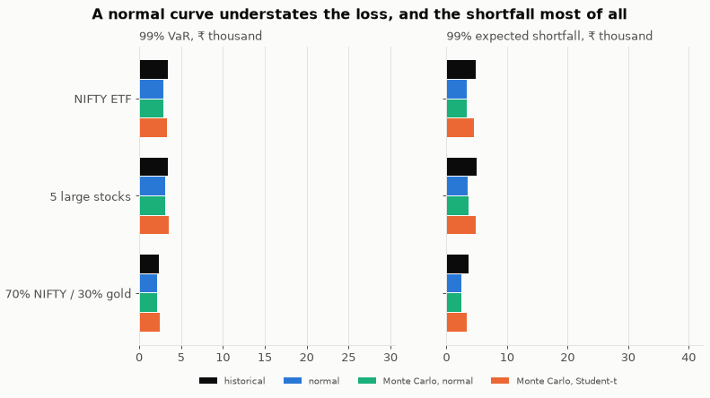

# Value at Risk

[](https://github.com/Dhirajdas18/value-at-risk/actions/workflows/ci.yml)
[](https://dhirajdas18.github.io/value-at-risk/)

How much a portfolio can lose on a bad day, measured the ways risk desks do and tested on NSE data since
2009: historical, parametric and Monte Carlo VaR, expected shortfall, formal backtests, filtered historical
simulation, extreme value theory, risk decomposition, stress tests and option positions.

**Live calculator: [dhirajdas18.github.io/value-at-risk](https://dhirajdas18.github.io/value-at-risk/)**.
Enter rupee holdings in any of today's NIFTY 50 stocks or the NIFTY and gold ETFs and get 1-day and 10-day
VaR and expected shortfall. It runs in your browser on five years of daily returns, rebuilt weekly; nothing
you enter leaves the page.

## Features

- [x] Historical, normal, Cornish-Fisher and Monte Carlo (normal, Student-t) VaR and expected shortfall; 10-day horizons
- [x] In-browser calculator, tested against the Python implementation through Node
- [ ] Backtesting: Kupiec, Christoffersen, Basel traffic light
- [ ] Filtered historical simulation (EWMA / GARCH)
- [ ] Expected shortfall at 97.5% and its backtest
- [ ] Extreme value theory for 99.9%
- [ ] Marginal and component VaR; historical stress scenarios
- [ ] Options: delta-gamma vs full revaluation

## Findings

### 1. A normal curve put NIFTY's 99% one-day loss 14% too low and its expected shortfall 32% too low

<a href="docs/img/methods_distribution.png"><picture><source media="(prefers-reduced-motion: reduce)" srcset="docs/img/methods_distribution.png"></picture></a>

₹10 lakh in three portfolios, daily returns from January 2009 to November 2026 (4,413 days): the NIFTY 50
ETF (NIFTYBEES), five large stocks in equal amounts (Reliance, HDFC Bank, Infosys, TCS, ITC), and 70% NIFTY
ETF / 30% gold ETF (GOLDBEES). VaR at 99% is the one-day loss exceeded on only 1% of days; expected
shortfall (ES) is the average loss on those days.

| ₹10 lakh, 99%, one day | Historical | Normal | Monte Carlo, normal | Monte Carlo, Student-t |
|---|---|---|---|---|
| NIFTY ETF: VaR / ES | ₹28,457 / ₹41,419 | ₹24,436 / ₹28,078 | ₹24,555 / ₹28,250 | ₹27,881 / ₹38,845 |
| 5 large stocks | ₹28,362 / ₹40,288 | ₹25,385 / ₹29,192 | ₹25,635 / ₹29,362 | ₹29,127 / ₹39,897 |
| 70% NIFTY / 30% gold | ₹19,573 / ₹31,263 | ₹18,114 / ₹20,833 | ₹18,206 / ₹20,923 | ₹20,748 / ₹28,282 |

- **The bell curve is too thin in the tail:** for the NIFTY ETF, normal VaR was 14% below historical and
  normal ES 32% below. The normal 99% VaR was breached on 1.45% of days instead of 1%.
- **Monte Carlo is only as good as its assumption:** with normal draws it reproduced the normal formula;
  with Student-t draws matched to the data's fat tails (4.3 degrees of freedom) it came within 2% of
  historical VaR and 6% of historical ES.
- **Cornish-Fisher broke:** its correction for skew and fat tails is only valid while the corrected curve
  keeps rising, which fails above roughly 6 of excess kurtosis (Maillard 2012); NIFTY's daily returns had
  17.7, and it returned an absurd ₹67,903. The calculator checks this and says so.
- **Gold cut the risk:** moving 30% into gold lowered historical VaR from ₹28,457 to ₹19,573.

<table><tr>
<td><a href="docs/img/methods_compare.png"><picture><source media="(prefers-reduced-motion: reduce)" srcset="docs/img/methods_compare.png"></picture></a></td>
<td><a href="docs/img/methods_horizon.png"><picture><source media="(prefers-reduced-motion: reduce)" srcset="docs/img/methods_horizon.png"></picture></a></td>
</tr></table>

- **The √10 shortcut (right):** regulators scale one-day VaR to ten days by √10. On the NIFTY ETF that
  matched actual ten-day VaR (from overlapping ten-day windows) at 95% (4.8% vs 4.9%) but overstated it at
  99% (9.0% vs 7.7%) and 99.5% (11.1% vs 9.2%). Ten-day returns have thinner tails than daily ones: excess
  kurtosis 17.8 for daily returns against 8.4 for non-overlapping ten-day returns.

## Quick start

```bash
uv sync
uv run python scripts/fetch_data.py         # Yahoo Finance -> data/prices.parquet
uv run var report methods                   # charts -> out/
uv run python scripts/build_site.py         # dashboard and calculator -> site/index.html
uv run pytest
```

## Design

- `src/var/var.py`: historical, normal, Cornish-Fisher (with a validity check) and Monte Carlo VaR and
  ES; portfolio returns from rupee holdings; overlapping multi-day returns.
- `src/var/var.js`, `calculator.html`: the same methods in the browser; a test runs them through Node
  against Python. Five years of returns are embedded as integers (0.001% units).
- `src/var/data.py`: Yahoo prices for today's NIFTY 50 and two ETFs since 2007, with known errors
  repaired from `docs/data/yahoo_fixes.csv` (unadjusted corporate actions, bad prints, histories that
  belong to another company), each with its source.
- `src/var/reports.py`: README findings, reproducible with `var report <topic>`.
- `src/var/site.py`, `page.html`: the dashboard, one static page; no server.

MIT licence.
