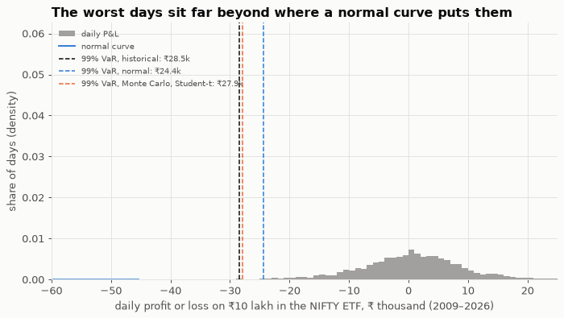
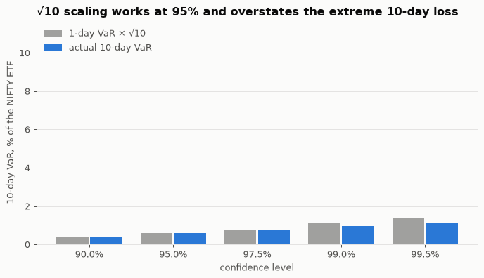
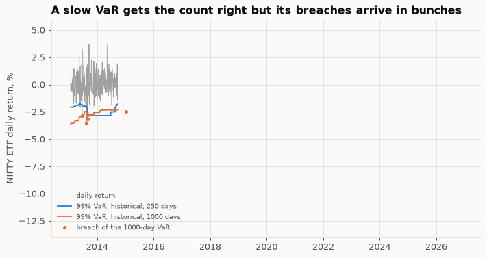
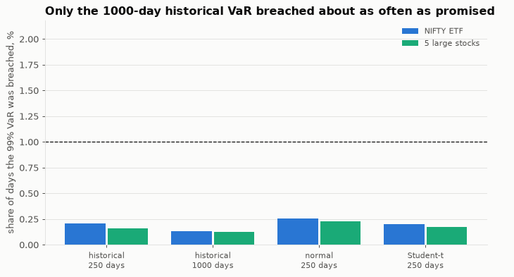
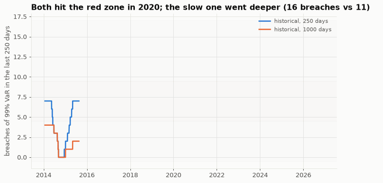
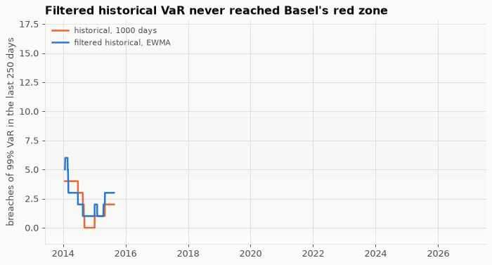
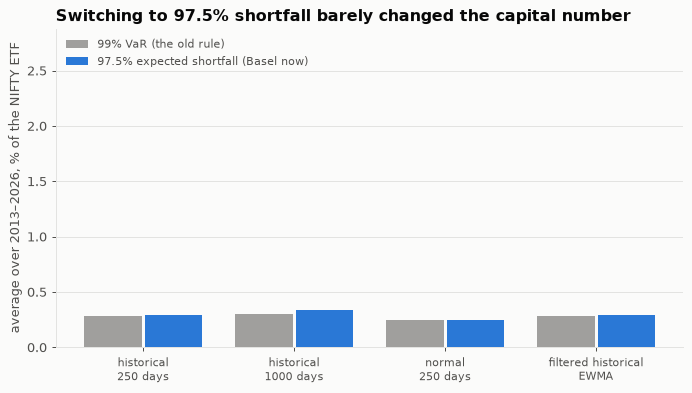

# Value at Risk

[](https://github.com/Dhirajdas18/value-at-risk/actions/workflows/ci.yml)
[](https://dhirajdas18.github.io/value-at-risk/)

How much a portfolio can lose on a bad day, measured the ways risk desks do and tested on NSE data since
2009: historical, parametric and Monte Carlo VaR, expected shortfall, formal backtests, filtered historical
simulation, extreme value theory, risk decomposition, stress tests and option positions.

**Live calculator: [dhirajdas18.github.io/value-at-risk](https://dhirajdas18.github.io/value-at-risk/)**.
Enter rupee holdings in any of today's NIFTY 50 stocks or the NIFTY and gold ETFs and get 1-day and 10-day
VaR and expected shortfall. It runs in your browser on five years of daily returns, rebuilt weekly; nothing
you enter leaves the page.

## Features

- [x] Historical, normal, Cornish-Fisher and Monte Carlo (normal, Student-t) VaR and expected shortfall; 10-day horizons
- [x] In-browser calculator, tested against the Python implementation through Node
- [x] Backtesting: Kupiec, Christoffersen, Basel traffic light
- [x] Filtered historical simulation (EWMA / GARCH), also in the calculator
- [x] Expected shortfall at 97.5% and its backtest (Acerbi-Székely)
- [ ] Extreme value theory for 99.9%
- [ ] Marginal and component VaR; historical stress scenarios
- [ ] Options: delta-gamma vs full revaluation

## Findings

### 1. A normal curve put NIFTY's 99% one-day loss 14% too low and its expected shortfall 32% too low

<a href="docs/img/methods_distribution.png"><picture><source media="(prefers-reduced-motion: reduce)" srcset="docs/img/methods_distribution.png"></picture></a>

₹10 lakh in three portfolios, daily returns from January 2009 to November 2026 (4,413 days): the NIFTY 50
ETF (NIFTYBEES), five large stocks in equal amounts (Reliance, HDFC Bank, Infosys, TCS, ITC), and 70% NIFTY
ETF / 30% gold ETF (GOLDBEES). VaR at 99% is the one-day loss exceeded on only 1% of days; expected
shortfall (ES) is the average loss on those days.

| ₹10 lakh, 99%, one day | Historical | Normal | Monte Carlo, normal | Monte Carlo, Student-t |
|---|---|---|---|---|
| NIFTY ETF: VaR / ES | ₹28,457 / ₹41,419 | ₹24,436 / ₹28,078 | ₹24,555 / ₹28,250 | ₹27,881 / ₹38,845 |
| 5 large stocks | ₹28,362 / ₹40,288 | ₹25,385 / ₹29,192 | ₹25,635 / ₹29,362 | ₹29,127 / ₹39,897 |
| 70% NIFTY / 30% gold | ₹19,573 / ₹31,263 | ₹18,114 / ₹20,833 | ₹18,206 / ₹20,923 | ₹20,748 / ₹28,282 |

- **The bell curve is too thin in the tail:** for the NIFTY ETF, normal VaR was 14% below historical and
  normal ES 32% below. The normal 99% VaR was breached on 1.45% of days instead of 1%.
- **Monte Carlo is only as good as its assumption:** with normal draws it reproduced the normal formula;
  with Student-t draws matched to the data's fat tails (4.3 degrees of freedom) it came within 2% of
  historical VaR and 6% of historical ES.
- **Cornish-Fisher broke:** its correction for skew and fat tails is only valid while the corrected curve
  keeps rising, which fails above an excess kurtosis of 8 when there is no skew (its slope at the centre is
  1 − 3K/24); NIFTY's daily returns had 17.7, and it returned an absurd ₹67,903. The calculator checks this and says so.
- **Gold cut the risk:** moving 30% into gold lowered historical VaR from ₹28,457 to ₹19,573.

<table><tr>
<td><a href="docs/img/methods_compare.png"><picture><source media="(prefers-reduced-motion: reduce)" srcset="docs/img/methods_compare.png"></picture></a></td>
<td><a href="docs/img/methods_horizon.png"><picture><source media="(prefers-reduced-motion: reduce)" srcset="docs/img/methods_horizon.png"></picture></a></td>
</tr></table>

- **The √10 shortcut (right):** regulators scale one-day VaR to ten days by √10. On the NIFTY ETF that
  matched actual ten-day VaR (from overlapping ten-day windows) at 95% (4.8% vs 4.9%) but overstated it at
  99% (9.0% vs 7.7%) and 99.5% (11.1% vs 9.2%). Ten-day returns have thinner tails than daily ones: excess
  kurtosis 17.8 for daily returns against 8.4 for non-overlapping ten-day returns.

### 2. Only a slow VaR breached as often as promised, and its breaches came in bunches

<a href="docs/img/backtest_breaches.png"><picture><source media="(prefers-reduced-motion: reduce)" srcset="docs/img/backtest_breaches.png"></picture></a>

Each day from January 2013 to November 2026 (3,413 days), a 99% VaR forecast from past data only, compared
with that day's return. A good VaR is breached on about 1% of days (Kupiec's test) and its breaches arrive at
random, not in clusters (Christoffersen's test: is a breach more likely the day after a breach?).

| NIFTY ETF, 99% | Breaches | Right count? (Kupiec p) | Breach the day after a breach | Days in Basel red |
|---|---|---|---|---|
| Historical, 250 days | 1.70% | no (p < 0.01) | 5.2% | 6% |
| Historical, 1000 days | **1.08%** | **yes (p = 0.63)** | **18.9%** (p < 0.01) | 8% |
| Normal, 250 days | 2.08% | no (p < 0.01) | 9.9% | 12% |
| Student-t, 250 days | 1.67% | no (p < 0.01) | 8.8% | 7% |

- **Every one-year method breached too often:** 1.67% to 2.08% of days against the promised 1%, the normal
  curve worst of all.
- **The 1000-day VaR got the count right but not the timing:** after a breach, another followed the next day
  18.9% of the time instead of 1%. As the chart above shows, its VaR barely moved through March 2020 while
  the 250-day VaR rose to 6%, and it was breached again and again.

<table><tr>
<td><a href="docs/img/backtest_rates.png"><picture><source media="(prefers-reduced-motion: reduce)" srcset="docs/img/backtest_rates.png"></picture></a></td>
<td><a href="docs/img/backtest_traffic.png"><picture><source media="(prefers-reduced-motion: reduce)" srcset="docs/img/backtest_traffic.png"></picture></a></td>
</tr></table>

- **Five stocks behaved better (left):** the same methods on the five-stock portfolio breached less often
  (1.03% to 1.85%) and no method's breaches clustered significantly.
- **The Basel traffic light (right):** both historical VaRs reached the red zone (10 or more breaches in 250
  days) in 2020; the 1000-day VaR went deeper, to 16 breaches against 11, and stayed red from March 2020 to
  March 2021.

### 3. Rescaling history to today's volatility passed both backtests and never reached Basel's red zone

<a href="docs/img/fhs_scorecard.png"><picture><source media="(prefers-reduced-motion: reduce)" srcset="docs/img/fhs_scorecard.png"></picture></a>

Filtered historical simulation divides each past day's return by that day's volatility forecast, keeps the
resulting shocks, and scales their historical quantile by tomorrow's volatility forecast: the tail's shape
comes from history and its size from today. Volatility is EWMA (RiskMetrics, λ 0.94) or GARCH(1,1)
refitted monthly on the previous 500 days; shocks from the previous 500 days. Same days as section 2.

| NIFTY ETF, 99%, 2013–2026 | Breaches | Right count? (Kupiec p) | Breach the day after a breach | Most breaches in 250 days |
|---|---|---|---|---|
| Historical, 1000 days | 1.08% | yes (0.63) | 18.9% (p < 0.01) | 16 (red) |
| EWMA volatility, normal curve | 2.05% | no (p < 0.01) | 1.4% | 12 (red) |
| **Filtered historical, EWMA** | **1.08%** | **yes (0.63)** | **2.7% (p = 0.42)** | **8** |
| Filtered historical, GARCH | 1.29% | yes (0.10) | 2.3% (p = 0.60) | 8 |

- **Two ingredients, two fixes:** scaling by current volatility fixed the timing (EWMA with a normal curve
  stopped clustering, 1.4% repeat breaches) but not the count (2.05%); keeping history's fat-tailed shocks
  fixed the count. Filtered historical simulation has both.
- **Cheaper on average:** its average VaR was 2.34% of the portfolio against 2.51% for the 1000-day method,
  with the same breach count.
- **Five stocks agree:** filtered historical, EWMA breached 1.08% of days there too, with no clustering.

<table><tr>
<td><a href="docs/img/fhs_crash.png"><picture><source media="(prefers-reduced-motion: reduce)" srcset="docs/img/fhs_crash.png"></picture></a></td>
<td><a href="docs/img/fhs_traffic.png"><picture><source media="(prefers-reduced-motion: reduce)" srcset="docs/img/fhs_traffic.png"></picture></a></td>
</tr></table>

- **March 2020 (left):** on 23 March 2020 the filtered historical VaR stood at 10.0% of the portfolio,
  against 2.3% for the 1000-day historical VaR; the filtered one was breached early in the fall and then
  kept pace, the 1000-day one again and again.
- **Basel (right):** filtered historical VaR peaked at 8 breaches in 250 days (yellow) and never went red.

### 4. Basel's 97.5% expected shortfall asked for about the same capital as 99% VaR, and its backtest caught the methods that understate tail losses

<a href="docs/img/es_backtest.png"><picture><source media="(prefers-reduced-motion: reduce)" srcset="docs/img/es_backtest.png"></picture></a>

Basel's market-risk rules (FRTB) replaced 99% VaR with 97.5% expected shortfall: the average loss on the
worst 2.5% of days. For a bell curve the two are almost equal (2.338 against 2.326 standard deviations); ES
also responds to how bad the tail is. Same days and methods as sections 2–3 (filtered historical with 500
days of shocks). The backtest is Acerbi and Székely's Z2: the average of each day's return on breach days
divided by its forecast ES, which is 0 for a correct ES and negative when ES is too small; its p-value comes
from 1,000 simulations drawn from each day's own forecast distribution.

| 97.5% ES, 2013–2026 | NIFTY ETF: ES vs 99% VaR | Z2 (p) | 5 large stocks: Z2 (p) |
|---|---|---|---|
| Historical, 250 days | 2.40% vs 2.35% | −0.42 (p < 0.01) | −0.32 (p = 0.06) |
| Historical, 1000 days | 2.77% vs 2.51% | +0.05 (p = 0.66) | +0.00 (p = 0.47) |
| Normal, 250 days | 2.03% vs 2.02% | −0.61 (p < 0.01) | −0.50 (p < 0.01) |
| Filtered historical, EWMA | 2.37% vs 2.34% | −0.13 (p = 0.21) | −0.10 (p = 0.30) |

- **Same capital, better question:** ES at 97.5% averaged within 3% of 99% VaR for every method except the
  1000-day window (10% higher).
- **The backtest rejected the bell curve on both portfolios** and one-year history on the NIFTY ETF;
  filtered historical and the 1000-day window passed.
- **Z2 doesn't test timing:** the 1000-day window passed here, although its breaches clustered in section 2.
  An ES backtest checks the size of tail losses, not whether they bunch.

<table><tr>
<td><a href="docs/img/es_capital.png"><picture><source media="(prefers-reduced-motion: reduce)" srcset="docs/img/es_capital.png"></picture></a></td>
<td><a href="docs/img/es_by_year.png"><picture><source media="(prefers-reduced-motion: reduce)" srcset="docs/img/es_by_year.png"></picture></a></td>
</tr></table>

- **Where the shortfall fell short (right):** on days the 97.5% VaR was breached, losses exceeded the
  one-year historical ES forecast by 1.3 points on average in 2020; filtered historical's gap that year was
  0.5 points.

## Quick start

```bash
uv sync
uv run python scripts/fetch_data.py         # Yahoo Finance -> data/prices.parquet
uv run var report methods                   # also: backtest, fhs, es; charts -> out/
uv run python scripts/build_site.py         # dashboard and calculator -> site/index.html
uv run pytest
```

## Design

- `src/var/var.py`: historical, normal, Cornish-Fisher (with a validity check) and Monte Carlo VaR and
  ES; portfolio returns from rupee holdings; overlapping multi-day returns.
- `src/var/backtest.py`: rolling VaR forecasts, Kupiec and Christoffersen tests, Basel traffic light.
- `src/var/fhs.py`: EWMA and GARCH(1,1) volatility forecasts and filtered historical simulation.
- `src/var/es.py`: expected-shortfall forecasts and the Acerbi-Székely backtest with simulated p-values.
- `src/var/var.js`, `calculator.html`: the same methods in the browser; a test runs them through Node
  against Python. Five years of returns are embedded as integers (0.001% units).
- `src/var/data.py`: Yahoo prices for today's NIFTY 50 and two ETFs since 2007, with known errors
  repaired from `docs/data/yahoo_fixes.csv` (unadjusted corporate actions, bad prints, histories that
  belong to another company), each with its source.
- `src/var/reports.py`: README findings, reproducible with `var report <topic>`.
- `src/var/site.py`, `page.html`: the dashboard, one static page; no server.

MIT licence.
